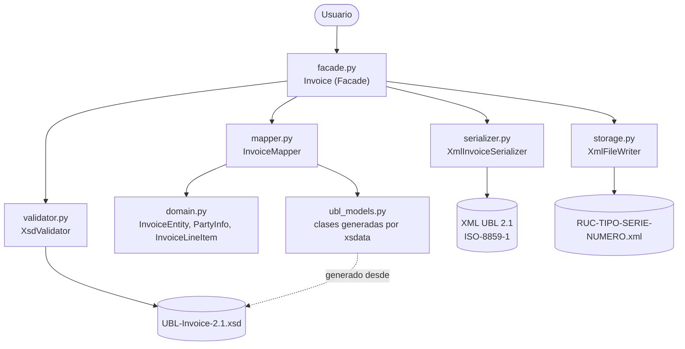
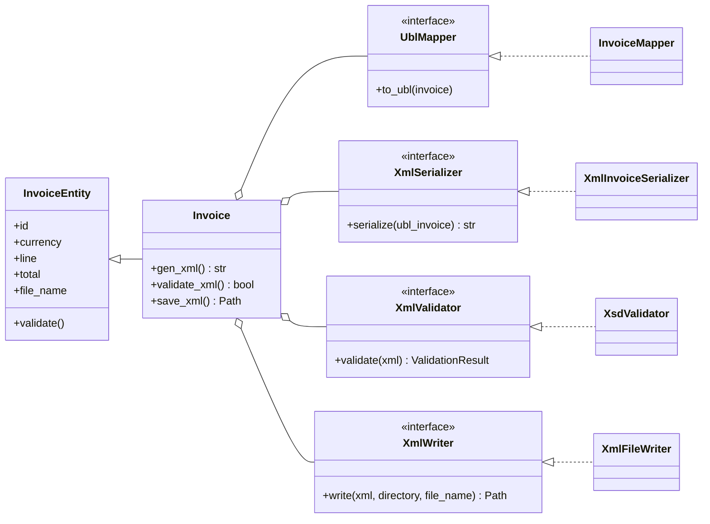

# XML Electronic Invoice Generator (UBL Invoice 2.1)

**Curso:** Arquitectura de Software — 2do Parcial
**Autor:** Roger Iván Ochoa Fernández

## 1. Descripción del caso

Los sistemas ERP necesitan emitir facturas electrónicas en XML según el estándar
**OASIS UBL 2.1** (`UBL-Invoice-2.1.xsd`). Un antipatrón común es construir el XML
concatenando cadenas o con plantillas fijas: produce errores de sintaxis, riesgo de
inyección XML, alto acoplamiento y dificultad para seguir cambios del esquema.

### Solución
1. **XML Data Binding:** `xsdata` genera clases Python (`ubl_models.py`) desde los XSD
   oficiales (carpeta `xsd/`). El XML se obtiene serializando objetos, sin plantillas.
   El escape de caracteres especiales lo hace el serializador (hay una prueba que lo verifica).
2. **Facade (`ubl_invoice/facade.py`):** la clase `Invoice` expone una interfaz simple y oculta la
   complejidad de UBL, orquestando las capas de mapeo, serialización y validación.
3. **Arquitectura en capas:** cada responsabilidad vive en su propio módulo y las
   dependencias apuntan hacia el dominio (ver sección 2).

Limitación declarada: el documento cumple el XSD 2.1, pero **no** implementa las reglas
adicionales de SUNAT (RUC, tipo de comprobante, etc.).

## 2. Arquitectura



_Flujo: el usuario habla solo con la fachada; esta orquesta mapeo, serialización y validación. El dominio no conoce a nadie._

| Capa | Módulo | Responsabilidad | Depende de |
|---|---|---|---|
| Fachada | `facade.py` | Interfaz pública `Invoice`; recibe sus colaboradores por parámetro | `ports.py` (y las implementaciones por defecto) |
| Puertos | `ports.py` | Contratos `UblMapper`, `XmlSerializer`, `XmlValidator`, `XmlWriter` | dominio |
| Dominio | `domain.py` | Entidades, reglas de negocio (moneda, fechas, total) | nada externo |
| Mapeo | `mapper.py` | Dominio → clases UBL | dominio, `ubl_models` |
| Serialización | `serializer.py` | Clases UBL → texto XML | xsdata |
| Validación | `validator.py` | XML → conforme al XSD 2.1 | lxml |
| Almacenamiento | `storage.py` | XML → archivo físico `.xml` | `encoding.py` |
| Codificación | `encoding.py` | ISO-8859-1 compartida por serializador, validador y escritor | nada externo |

### Inyección de dependencias (DIP y Abierto/Cerrado)

`Invoice` no instancia a mano sus colaboradores: depende de los contratos de `ports.py` y
recibe el mapeador, el serializador y el validador por parámetro (opcionales, con
implementaciones por defecto). Así se puede cambiar el formato de salida o la forma de
validar **sin modificar `Invoice`**, y reemplazarlos por dobles de prueba:

```python
class MiValidador:
    def validate(self, xml):
        return ValidationResult(True, [])

factura = Invoice('F001-524', validator=MiValidador())   # sin parámetros usa los de siempre
```



Una prueba automática (`test_dominio_no_depende_de_infraestructura`) garantiza que el
dominio no importe xsdata, lxml ni las clases generadas.

## 3. Uso

```python
from invoice import Invoice, PartyInfo

factura = Invoice('F001-524')
factura.duedate = '20/02/2020'
factura.line.add
factura.line[0].quantity = 5
factura.line[0].unit_price = 20.0             # importe de la línea = 5 x 20 = 100.00
factura.tax_rate = 0.18                       # IGV 18 % (opcional; sin tasa no se emite impuesto)

factura.document_type = '01'                  # 01 = factura (por defecto), 03 = boleta
factura.currency = 'PEN'                      # moneda ISO 4217 (por defecto PEN)
factura.supplier = PartyInfo('Mi Empresa SAC', '20123456789')   # emisor
factura.customer = PartyInfo('Cliente Demo', '10456789012')     # cliente

# Una línea puede tener tasa propia: factura.line[0].tax_rate = 0  (exonerada)
# Alternativa: asignar el importe a mano con factura.line[0].amount = 100
# (si se asignan ambos, deben coincidir o se lanza ValueError)

xml = factura.genXML()
print(factura.validateXML())   # True si cumple el XSD

ruta = factura.save_xml()      # escribe 20123456789-01-F001-524.xml en la carpeta actual
print(ruta)
```

### Archivo `.xml` y codificación

`factura.save_xml()` (alias `saveXML()`) genera el XML, lo valida contra el XSD y lo escribe
como archivo físico en la **carpeta de trabajo actual** (o en `save_xml('ruta/carpeta')`).

| Aspecto | Regla |
|---|---|
| Nombre | `RUC-TIPO-SERIE-NUMERO.xml`, p. ej. `20123456789-01-F001-524.xml` |
| RUC | Sale de `factura.supplier.tax_id`; debe tener 11 dígitos |
| Tipo | `factura.document_type`: `01` factura (por defecto) o `03` boleta. Las notas de crédito/débito (`07`/`08`) usan otros esquemas UBL y no se soportan |
| Serie y número | Salen del id de la factura: formato `SERIE-NUMERO` (4 caracteres en mayúscula, guion y hasta 8 dígitos). El número se conserva tal cual, para que coincida con `cbc:ID` |
| Codificación | **ISO-8859-1**: el encabezado dice `encoding="ISO-8859-1"` y los bytes del archivo son realmente latin-1 (la `ñ` ocupa un byte) |
| Caracteres fuera de latin-1 | Se escriben como referencia numérica (`€` → `&#8364;`): el XML sigue siendo válido y no se pierde texto |
| Si el XML no cumple el XSD | Lanza `ValueError` y **no escribe nada** (`validate=False` omite la validación) |
| Si el archivo ya existe | Se sobrescribe |

Los archivos `.xml` generados en la raíz del proyecto están en el `.gitignore`.

### Impuestos (IGV)

Los impuestos son **opcionales**: sin `tax_rate` la factura sale sin elementos de impuesto,
igual que antes. Con `factura.tax_rate = 0.18` el XML incluye:

- `cac:TaxTotal` en **cada línea** (base imponible, impuesto y categoría).
- `cac:TaxTotal` en la **factura**, con un `cac:TaxSubtotal` por cada tasa distinta.
- `cac:LegalMonetaryTotal` con subtotal, base sin impuesto, total con impuesto y monto a pagar.

Reglas de cálculo:

| Regla | Detalle |
|---|---|
| Tasa | Fracción entre 0 y 1 (`0.18`). Un valor como `18` lanza `ValueError`. |
| Tasa por línea | `linea.tax_rate` reemplaza a la de la factura (`0` = exonerada, categoría `Z`). |
| Redondeo | 2 decimales, mitad hacia arriba (`0.125 → 0.13`), no el redondeo bancario de Python. |
| Impuesto de la factura | Suma de los impuestos de cada línea ya redondeados, para que los totales cuadren con las líneas. |
| Esquema | `TaxScheme` ID `1000`, nombre `IGV`, tipo `VAT`; categoría `S` (tasa general) o `Z` (tasa cero). |

Limitación declarada: se modela IGV con los códigos básicos; no se implementa el catálogo
completo de afectaciones de SUNAT (exonerado `9997`, inafecto `9998`, ISC, etc.).

## 4. Instalación y pruebas

Requiere **Python 3.10 o superior** (las clases generadas usan `dataclass(kw_only=True)`).

```bash
pip install -r requirements.txt
pytest -v
pytest --cov=ubl_invoice --cov-report=term-missing
```

## 5. Estructura

| Ruta | Contenido |
|---|---|
| `invoice.py` | Punto de entrada de compatibilidad (`from invoice import Invoice`) |
| `ubl_invoice/` | Paquete con las capas: `domain`, `ports`, `mapper`, `serializer`, `validator`, `storage`, `encoding`, `facade` |
| `ubl_models.py` | Clases generadas con xsdata (no editar a mano; ver sección 6) |
| `scripts/regenerar_modelos.py` | Regenera / verifica `ubl_models.py` desde el XSD |
| `xsd/` | Esquemas oficiales UBL 2.1 |
| `test_invoice.py` | Pruebas de generación de XML (extremo a extremo) |
| `test_layers.py` | Pruebas unitarias aisladas por capa |
| `test_injection.py` | Pruebas de inyección de dependencias con dobles de prueba |
| `test_regeneracion.py` | Pruebas del script de regeneración |
| `test_files.py` | Pruebas del nombre de archivo, la codificación ISO-8859-1 y la escritura |

## 6. Regenerar los modelos (`ubl_models.py`)

`ubl_models.py` es **código generado** por [xsdata](https://xsdata.readthedocs.io) a partir de
`xsd/maindoc/UBL-Invoice-2.1.xsd`. No se edita a mano. Para reproducirlo:

```bash
python scripts/regenerar_modelos.py           # regenera y sobrescribe ubl_models.py
python scripts/regenerar_modelos.py --check   # solo verifica que esté al día (código de salida 1 si no)
```

- El script genera en una carpeta temporal y copia solo `ubl_models.py`: `xsdata generate`
  deja además un `__init__.py` suelto de ~5 700 líneas que no debe entrar al proyecto.
- Comando equivalente que ejecuta por debajo:
  `xsdata generate <xsd> --package ubl_models --structure-style single-package`
- Verificado con **xsdata 26.10**: la salida es idéntica byte a byte al archivo versionado.
  Otra versión de xsdata puede producir diferencias de formato.
- Prueba opcional (lenta, ~6 s): `REGEN_CHECK=1 pytest test_regeneracion.py`
